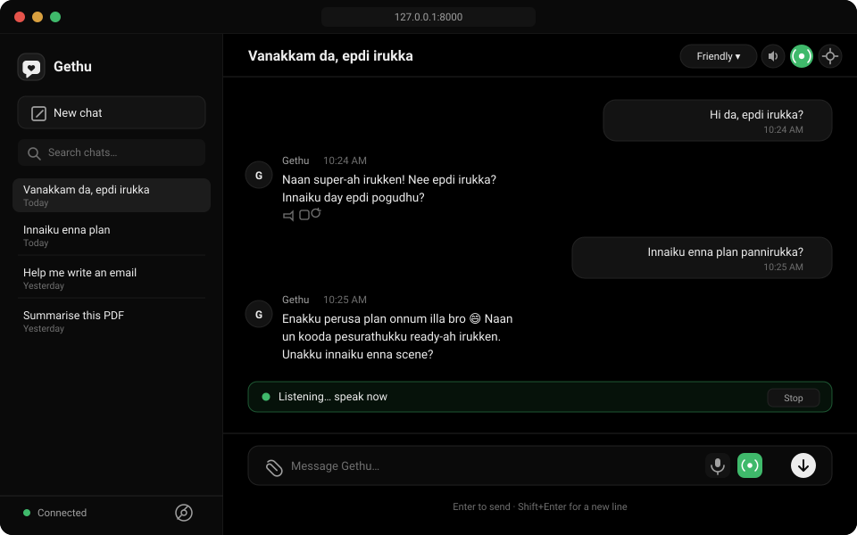

<div align="center">

# 🤝 Gethu

### Your friendly AI companion who speaks your language — literally.

**Tanglish conversations · Hands-free voice · 100% free to run · Your data stays on your machine**

[](https://python.org)
[](https://fastapi.tiangolo.com)
[](#-testing)
[](LICENSE)
[](#-why-it-costs-nothing)

---

### 👀 This is what Gethu looks like



*A true-to-scale view of the app: conversation history on the left, a natural
Tanglish chat in the middle, and the green **radio button** that starts hands-free
voice mode. Voice replies are spoken aloud by your browser.*


</div>

---

## What is Gethu?

**Gethu** (கெத்து) is a local AI companion you run on your own computer. Talk to it in
**Tanglish** — the natural Tamil + English mix you actually speak — or plain English.

It is a real, working app: it streams replies as they're written, remembers your
conversation, reads files you share, and can hold a **hands-free voice conversation**
where you just talk out loud and it answers back.

No subscription. No paid voice service. No cloud database. Just your machine and a
free Gemini API key.

```
You:  Hi da, epdi irukka?
Gethu: Naan super-ah irukken! Nee epdi irukka? Innaiku day epdi pogudhu?
```

> Gethu replies in **Romanized Tanglish or English** by default — never Tamil script
> unless you ask for it. That's what makes it feel like texting a friend, not a robot.

---

## ✨ Features

<table>
<tr>
<td width="50%" valign="top">

### 💬 Conversation
- **Streams replies** token-by-token as they generate
- **Natural Tanglish** or English — your choice of tone
- **5 modes:** Friendly, Respectful, Playful, Supportive, Focused
- **Remembers context** within a conversation
- Auto-trims history so it never gets bloated

### 🎙️ Voice — all free
- **Speech input** via your browser
- **Speech output** with male-voice preference
- **Auto-speak** replies as they arrive
- **Speed control** (0.6×–1.6×)
- **Live conversation mode** — hands-free!

</td>
<td width="50%" valign="top">

### 📎 Files
- Share **images, PDFs, and text files**
- Real file bytes go to Gemini — ask questions about them
- Validated by content, not extension
- Never executed, always size-limited

### 🗂️ History
- Every chat saved in local **SQLite**
- Search, rename, delete, clear-all
- Survives restarts

### 🎨 Interface
- Clean **dark theme** (true black), plus light mode
- Responsive — works on mobile too
- Markdown, code blocks, copy buttons

</td>
</tr>
</table>

### 🗣️ Live conversation mode

The feature that makes Gethu feel alive. Tap the **radio button**, and then just talk:

```
🎤 Listening  →  🧠 Thinking  →  🔊 Speaking  →  🎤 Listening  →  ...
```

It keeps going until you stop it. No clicking between turns — like a phone call.
The microphone is **released before Gethu speaks**, so it never hears itself and
loops on its own voice.

---

## 🚀 Quick Start

Pick your system. Both take about **3 minutes**.

> **⚡ Fastest path — one command.** The setup script checks your whole system
> before installing, so if something is missing it tells you exactly what to do.
> ```bash
> ./setup.sh && ./run.sh                        # Linux / macOS
> ```
> ```powershell
> .\setup.ps1 ; .\run.ps1                       # Windows
> ```
> Then just add your API key when prompted. Prefer to see each step? Read on.
>
> **What it checks for you** — Python 3.11+ (and tells you your version if it's
> too old), the `venv` module, your internet connection, free disk space, and
> whether port 8000 is already taken. Problems are collected and printed
> together at the end with the fix for each one.

<details open>
<summary><b>🐧 Linux / 🍎 macOS</b></summary>

**1. Check Python is installed**
```bash
python3 --version    # needs 3.11 or newer
```

**2. Get the project and set it up**
```bash
git clone https://github.com/AdhiHub/gethu-companion.git
cd gethu-companion

python3 -m venv .venv
source .venv/bin/activate
pip install -r requirements.txt
```

**3. Add your free API key**
```bash
cp .env.example .env
nano .env        # or: gedit .env
```
Paste your key after `GEMINI_API_KEY=`

**4. Run it**
```bash
uvicorn app.main:app --host 127.0.0.1 --port 8000
```

**5. Open** → <http://127.0.0.1:8000>

</details>

<details>
<summary><b>🪟 Windows</b></summary>

**1. Check Python is installed**

Open **PowerShell** and run:
```powershell
py --version         # needs 3.11 or newer
```
If that fails, install Python from [python.org](https://www.python.org/downloads/)
— **tick "Add Python to PATH"** during install.

**2. Get the project and set it up**
```powershell
git clone https://github.com/AdhiHub/gethu-companion.git
cd gethu-companion

py -m venv .venv
.\.venv\Scripts\Activate.ps1
pip install -r requirements.txt
```

> **PowerShell says "running scripts is disabled"?**
> Run this once, then retry:
> ```powershell
> Set-ExecutionPolicy -Scope CurrentUser RemoteSigned
> ```

**3. Add your free API key**
```powershell
Copy-Item .env.example .env
notepad .env
```
Paste your key after `GEMINI_API_KEY=`

**4. Run it**
```powershell
uvicorn app.main:app --host 127.0.0.1 --port 8000
```

**5. Open** → <http://127.0.0.1:8000>

</details>

<details>
<summary><b>🚫 No Git? Download instead</b></summary>

No `git` installed? That's fine:

1. Go to the repo page → green **Code** button → **Download ZIP**
2. Unzip it somewhere easy, like your Desktop
3. Open a terminal in that folder and skip the `git clone` line
4. Follow the same steps from `python3 -m venv .venv` onward

</details>

### 🔑 Getting your free Gemini API key

1. Go to **<https://aistudio.google.com/apikey>**
2. Sign in with a Google account
3. Click **Create API key**
4. Copy it into your `.env` file

The **free tier is plenty** to get started. You do not need to enter a credit card.

### ✅ Did it work?

Open <http://127.0.0.1:8000/api/health>. You should see:

```json
{"status":"ok","api_key_configured":true,"model":"gemini-3.5-flash","version":"0.1.0"}
```

`api_key_configured: true` means you're ready. If it says `false`, your `.env` isn't
being read — check the key is on the `GEMINI_API_KEY=` line with no quotes.

---

## 🎙️ Voice Setup (one-time)

Voice works **only in Chromium browsers** for input. Here's the honest table:

| Feature | Chrome / Edge / Brave | Firefox | Safari |
|---|:---:|:---:|:---:|
| Speech **input** (you talk) | ✅ | ❌ | ⚠️ partial |
| Speech **output** (it talks) | ✅ | ✅ | ✅ |
| **Live conversation mode** | ✅ | ❌ | ⚠️ partial |

### On Linux — install speech voices

If Gethu replies but you hear **nothing**, you likely have no system voices:

```bash
sudo apt install speech-dispatcher espeak-ng
```

Then **fully quit and reopen** your browser (not just the tab).

### On Brave — lower Shields

Brave blocks speech recognition by default. Click the **lion icon** in the address
bar → set **Shields down** for this site → reload. Gethu will warn you if this is
the problem.

### Using it

1. **🎤 Mic button** — dictate one message; text lands in the box so you can fix it
2. **📻 Radio button** — hands-free live conversation, keeps going until you stop
3. **🔊 Speaker button** — turn spoken replies on/off

> **Why does Tanglish sound a bit off?** Browser voices are general-purpose OS
> voices, not Tamil-native models. *"Innaiku"* may be read with English phonetics on
> one device and near-Tamil on another. That's a limit of the free browser stack —
> not a bug. Picking a Tamil (`ta-IN`) voice usually helps. The speech layer is
> isolated in `app/static/js/voice.js`, so a dedicated TTS service can be swapped in
> later without touching anything else.

---

## 💸 Why it costs nothing

Every piece of this stack is free:

| Piece | What it uses | Cost |
|---|---|---|
| **Replies** | Google Gemini free tier | Free |
| **Speech input** | Browser Web Speech API | Free |
| **Speech output** | Browser SpeechSynthesis | Free |
| **Storage** | SQLite on your disk | Free |

There is **no paid voice subscription anywhere** — no ElevenLabs, no Azure Speech,
no OpenAI TTS. The browser already has the speech engines built in; Gethu just
wires them together.

---

## ⚙️ Configuration

Everything lives in `.env` — the **only** file with secrets, and it's gitignored.

| Variable | Default | What it does |
|---|---|---|
| `GEMINI_API_KEY` | *(empty)* | **Required.** Your key. Never sent to the browser. |
| `GEMINI_MODEL` | `gemini-3.5-flash` | Which model to use. |
| `GEMINI_FALLBACK_MODELS` | `gemini-3.6-flash,…` | Tried in order if yours is unavailable. |
| `GETHU_HOST` | `127.0.0.1` | Bind address. Keep local. |
| `GETHU_PORT` | `8000` | Port. |
| `MAX_UPLOAD_MB` | `20` | Attachment size cap. |
| `MAX_HISTORY_MESSAGES` | `40` | Context window per request. |
| `LOG_LEVEL` | `INFO` | `DEBUG`/`INFO`/`WARNING`/`ERROR`. |

**Model not working?** Availability changes over time. The app automatically falls
back through the fallback list, and you can pick another in **Settings → Model**.

---

## 🧪 Testing

```bash
pytest                                   # 70 backend tests
ruff check app tests                     # lint
node --test "tests/frontend/*.test.mjs"  # 56 frontend tests
```

**126 tests total.** Frontend tests need Node 18+ and mock the browser speech APIs,
so no microphone, speaker, or API key is required.

---

## 🏗️ How it's built

```
gethu-companion/
├── app/
│   ├── main.py                     FastAPI factory, routers, error handlers
│   ├── config.py                   .env loading + validation
│   ├── api/
│   │   ├── chat.py                 POST /api/chat → SSE stream
│   │   ├── conversations.py        history CRUD
│   │   ├── attachments.py          upload / download / delete
│   │   └── settings.py             non-secret settings
│   ├── services/
│   │   ├── gemini_service.py       streaming, bounded retries, model failover
│   │   ├── conversation_service.py orchestration + SSE events
│   │   ├── prompt_service.py       system prompt, modes, history trimming
│   │   ├── attachment_service.py   content sniffing, safe storage
│   │   └── settings_service.py     persisted preferences
│   ├── database/                   SQLite connection + repository
│   ├── models/schemas.py           pydantic models
│   ├── prompts/                    the companion's system prompt
│   ├── utils/                      ids, logging redaction, IPv4 preference
│   └── static/
│       ├── index.html
│       ├── css/styles.css
│       ├── js/                     app, api, chat, voice, settings, markdown
│       └── vendor/                 marked, DOMPurify, lucide (local, no CDN)
├── tests/                          pytest + tests/frontend (node --test)
├── data/                           runtime DB + uploads (gitignored)
├── setup.sh · run.sh               one-command setup/start (Linux, macOS)
├── setup.ps1 · run.ps1             one-command setup/start (Windows)
└── .env.example · requirements.txt · pyproject.toml · LICENSE · NOTICE
```

### Design decisions worth knowing

- **User turn is persisted *before* the stream opens** — so attachment and permission
  errors return proper HTTP codes instead of breaking mid-stream.
- **Retries only happen before the first token** — a retry can never duplicate text
  you've already seen.
- **No CDN anywhere** — markdown, sanitizer and icons are all vendored locally, so it
  works fully offline except for the Gemini call itself.
- **`voice.js` is DOM-light and dependency-free** — that's why its logic is unit
  testable in Node with mocked browser APIs.
- **IPv4-first resolver** — some Linux hosts resolve IPv6 first but have no working
  IPv6 route, which silently breaks API calls. Gethu detects this and prefers IPv4.

---

## 🔒 Security & privacy

- API key lives **only** in `.env`, never reaches the browser, never gets logged
  (a redacting filter scrubs anything key-shaped).
- `.env`, the database, and uploads are **all gitignored**.
- Uploads are validated by **magic bytes**, size-limited, and stored under generated
  names inside one directory — path traversal is blocked.
- Model output passes through **DOMPurify** before it touches the DOM.
- **Gethu never turns on your microphone silently.** It only asks after you click,
  and only recognised *text* is sent — never raw audio.

> ⚠️ **This is a local, single-user app.** It binds to `127.0.0.1` by default. Before
> exposing it on a network, add authentication and TLS yourself.

---

## ❓ Troubleshooting

| Problem | Fix |
|---|---|
| **`api_key_configured: false`** | Check `.env` exists and `GEMINI_API_KEY=` has your key, no quotes. |
| **"No API key" in the UI** | Same as above — restart the server after editing `.env`. |
| **Mic button greyed out** | Browser has no speech recognition (Firefox). Use Chrome, Edge or Brave. |
| **Mic does nothing on Brave** | Lower Shields for the site (lion icon → down) and reload. |
| **Gethu replies but is silent** | Install voices: `sudo apt install speech-dispatcher espeak-ng`, then restart the browser. |
| **"needs HTTPS or localhost"** | Open `http://127.0.0.1:8000`, not a LAN IP. |
| **"Microphone permission was blocked"** | Allow the mic in the address-bar padlock menu, reload. |
| **Replies error out** | Try another model in **Settings → Model**. |
| **`ensurepip` error on Linux** | `sudo apt install python3-venv` then retry — `./setup.sh` detects this for you. |
| **Old version loading after edits** | Hard-reload: `Ctrl + Shift + R`. |
| **Port 8000 already in use** | `GETHU_PORT=8001 ./run.sh` — `./setup.sh` checks this up front. |

---

## 📌 Known limitations

Worth being upfront about:

- **Speech input needs a Chromium browser.** Firefox doesn't implement it.
- **Tanglish pronunciation is approximate** — see the note above.
- **Voice quality varies** by device and OS.
- **Automatic tests mock the browser APIs** — they cover logic, not real audio. A
  real microphone check is manual.
- **Not full-duplex.** Wake-word activation is intentionally not implemented.

## 🔭 Ideas for later

- A dedicated low-latency STT/TTS provider (the voice layer is already isolated)
- Wake-word activation
- Long-term memory with explicit user control
- Web search and reminders
- Packaged desktop build

---

## 📄 License & credit

**Gethu is licensed under the [Apache License 2.0](LICENSE).**

Plain English version:

| | |
|---|---|
| ✅ **Use it** | Run it, study it, change it, share it — personal or commercial |
| ✅ **Build on it** | Fork it, remix it, ship your own version |
| ✅ **Modify it** | Rewrite as much as you like |
| ⚠️ **Keep the credit** | Any copy or modified version you distribute **must keep the `LICENSE` and [`NOTICE`](NOTICE) files**, including the copyright line `Copyright 2026 AdhiHub` |
| ⚠️ **Include the notice** | Modified versions must state clearly that you changed the files |
| ❌ **Don't claim authorship** | You may not remove the copyright or present the original work as your own |
| ❌ **Don't use the name** | You may not use "Gethu" or the author's name to endorse or promote your version without permission |
| ❌ **No warranty** | Provided as-is; the author is not liable for anything |

In short: **take it, learn from it, build with it — just don't erase who made it.**

<details>
<summary><b>What that looks like for a fork</b></summary>

If you fork Gethu and publish your version:

```
your-fork/
├── LICENSE      ← keep this (Apache-2.0)
├── NOTICE       ← keep this, with "Copyright 2026 AdhiHub"
└── README.md    ← add a line like:
                    "Based on Gethu by AdhiHub — https://github.com/AdhiHub/gethu-companion"
```

That's it. You're free to use and change everything else.
</details>

<div align="center">

Built with [FastAPI](https://fastapi.tiangolo.com),(https://ai.google.dev),
and the browser's own speech engine.

**If Gethu made you smile, give the repo a ⭐**

</div>
